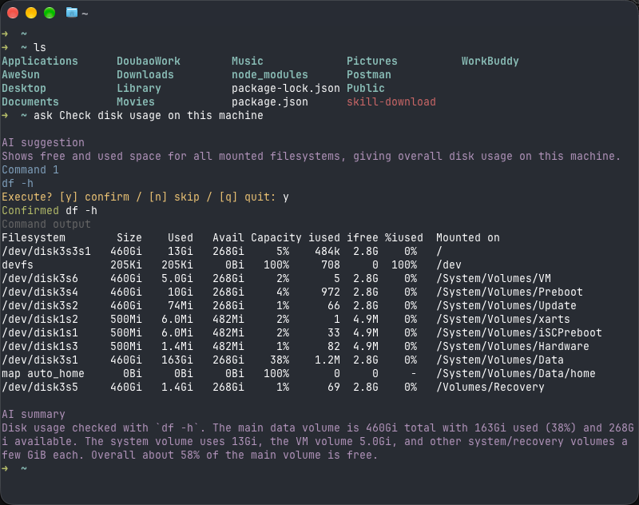

# AskMe

**Describe a task in plain language. Review and run AI-suggested commands in your terminal.**

AskMe is a command-line assistant built with TypeScript. It uses your working directory, Shell history, and previous AskMe interactions to plan commands, streams their output, and uses the results to decide what to do next.

**macOS · Windows · Linux · Node.js ≥ 24 · MIT License**

Project name: **AskMe**. npm package: `askme`. Terminal command: `ask`.

[Quick start](#quick-start) · [Usage](#usage) · [Configuration](#configuration) · [History and data](#history-and-data) · [Troubleshooting](#troubleshooting) · [Development and contributing](#development-and-contributing)



*AskMe checking disk usage: review the command, confirm execution, and read the summary.*

## Why AskMe

- **Work in your terminal**: Describe your goal, review a command and its explanation, and confirm before execution.
- **Complete tasks over multiple steps**: Feed exit codes and output back to the model so it can plan the next command.
- **Use existing context**: Reference recent commands and AskMe interactions, including accepted and declined commands for the same question.
- **Share a local daemon**: The background service starts automatically, while each task maintains its own conversation, confirmations, and output.
- **Choose your model**: Connect a `/chat/completions`-compatible service using saved settings or environment variables.

Built-in CLI messages are in English. Model-generated explanations and summaries can follow the language of your request.

## Quick start

### Requirements

- Node.js **24 or later** and npm.
- macOS, Windows, or Linux. Windows uses the built-in Windows PowerShell 5.1; macOS and Linux use your configured Unix Shell.
- An API URL, key, and model name for an OpenAI Chat Completions-compatible service.

### 1. Install from source

Clone the repository and install from its root directory:

```sh
git clone https://github.com/hangyuRen/AskMe.git
cd AskMe
```

```sh
npm ci
npm run build
npm install -g .
```

Verify the installation:

```sh
ask --help
```

These instructions cover installation from source. Uploading this repository to GitHub does not publish an npm package or a Homebrew formula. The [Homebrew formula template](packaging/askme.rb.template) still requires a published release URL and checksum before it can be used for distribution.

### 2. Configure your model service

Run the configuration command once:

```sh
ask config
```

Enter your API URL, API key, and model name when prompted. API key input is hidden. Settings are saved in `~/.ask/config.json` and loaded automatically in future terminals.

If you already exported all three `ASKME_API_*` variables in the current terminal, `ask config` saves those values directly without prompting. You can also rerun it to update saved settings; in interactive setup, Enter keeps an existing value.

Environment variables remain available for temporary overrides. In macOS/Linux Shells:

```sh
export ASKME_API_URL="https://your-api-host/v1"
export ASKME_API_KEY="your-api-key"
export ASKME_API_MODEL="your-model-name"
```

In Windows PowerShell:

```powershell
$env:ASKME_API_URL="https://your-api-host/v1"
$env:ASKME_API_KEY="your-api-key"
$env:ASKME_API_MODEL="your-model-name"
```

These assignments alone apply only to the current terminal and its child processes. Run `ask config` to save them for future sessions.

### 3. Run your first task

```sh
ask "Find the largest files in the current directory"
```

The daemon starts automatically. Each command is displayed in full and runs only after you enter `y`.

## Usage

### Describe a task

```sh
ask "Show the changes in my Git working tree"
ask "Investigate why this project's tests are failing"
ask "Check disk usage on this machine"
```

Your input is sent to the model as a task description. Even input that looks like a Shell command is interpreted as a request rather than executed directly.

### Confirm or cancel

| Input | Action |
| --- | --- |
| `y` | Execute the proposed command and send its result to the model |
| `n` | Decline the command and let the model decide what to do next |
| `q` | End the current task |
| `Ctrl+C` | Cancel the task and attempt to terminate the running command |

Any response other than `y` or `q` is treated as a decline. A task can span multiple commands, with no fixed limit on the number of steps.

### Manage the daemon

On macOS/Linux:

```sh
command ask daemon status
command ask daemon stop
```

On Windows PowerShell or Command Prompt:

```powershell
ask daemon status
ask daemon stop
```

After stopping the daemon, submitting another task starts it again automatically. You can also request startup directly:

```sh
ask "Start ask service"
```

Service management requires no API configuration and does not call the model. On macOS/Linux, `command ask` invokes the executable directly, bypassing any Shell function with the same name.

### Include current zsh history

This optional integration applies to macOS/Linux with zsh. It is not required for the main CLI.

Add this line to `~/.zshrc`, then open a new terminal:

```sh
eval "$(command ask init zsh)"
```

This registers an `ask` Shell function that passes recent commands from the current terminal to the client. Up to 10 commands are retained after filtering. Without this integration, AskMe can still read commands already saved to the history file, but may miss recent activity in the current session.

## Configuration

| Environment variable | Required | Description |
| --- | --- | --- |
| `ASKME_API_URL` | Unless saved | API base URL, such as `https://your-api-host/v1`; a full `/chat/completions` endpoint is also supported |
| `ASKME_API_KEY` | Unless saved | Model service key, sent using Bearer authentication |
| `ASKME_API_MODEL` | Unless saved | Model identifier supported by your service |
| `HISTFILE` | No | History file to read when no file is explicitly supplied by the Shell integration; must be exported |
| `ASK_COLOR` | No | `always` forces colors; `never` disables them; otherwise colors depend on the terminal |
| `NO_COLOR` | No | Disables colors whenever set, taking precedence over `ASK_COLOR` |

API settings are read on each invocation, so changing them does not require restarting the daemon. Nonempty environment variables override individual saved fields; otherwise AskMe uses `~/.ask/config.json`. Temporary overrides do not change the file unless you run `ask config`. Use the `ASKME_API_*` variables above; unprefixed `API_URL`, `API_KEY`, and `API_MODEL` are not used as configuration. If required settings are missing, the client suggests `ask config` and displays an environment configuration example instead of starting an AI task.

In interactive terminals, commands appear in blue, AI explanations and summaries in purple, and confirmation prompts in yellow. Colors are disabled by default when output is redirected or piped.

## Platform support

| Platform | Command execution | Local communication | Default history source |
| --- | --- | --- | --- |
| macOS | `$SHELL`, then zsh or sh | Unix domain socket | zsh/bash history |
| Linux | `$SHELL`, then bash or sh | Unix domain socket | zsh/bash history |
| Windows | Windows PowerShell 5.1, without profiles | Per-user named pipe | PowerShell PSReadLine history |

Platform adapters are implemented for all three systems. macOS has been tested locally; native Windows and Linux validation is provided by the [CI matrix](.github/workflows/ci.yml). Check the latest results before treating a platform as verified.

You can launch the Windows CLI from PowerShell or Command Prompt. Generated commands always run in Windows PowerShell, so requests include the OS and execution Shell to help the model use the correct syntax. Windows PowerShell 5.1 uses semicolons rather than `&&` to separate commands.

On Unix, cancellation signals the command's process group. On Windows, it uses `taskkill /T /F` to terminate the process tree. Windows Command Prompt has no persistent history file that AskMe can read; the automatic Windows history source is PSReadLine's `ConsoleHost_history.txt`, or an explicitly exported `HISTFILE`.

## How it works

```text
Request + working directory + recent history
                    ↓
          Model generates an Action
                    ↓
       Local validation and command display
                    ↓
             User confirmation
                    ↓
       Client executes and streams output
                    ↓
          Result sent to the model
                    ↓
          Next command / final summary
```

- **Generation and validation**: The client-server workflow validates the `Action` structure, field types, command length, and recursive AskMe invocations. Validation errors are sent together to the model for correction. Valid commands do not trigger a second model review.
- **Timeouts and retries**: Each request has a 30-second timeout, including reading the response body. Each planning round allows at most 3 model calls, shared between connection retries and response corrections.
- **Failure handling**: Persistent connection failures, HTTP errors, or timeouts produce `The LLM is currently unavailable. Please try again later.` Persistently invalid responses produce a message explaining that a valid result could not be generated.
- **Task scope**: The prompt tells the model to prioritize the current request, reference history only when relevant, and avoid resuming old tasks without an explicit connection to the current request.

Commands run in a non-interactive Shell subprocess, using the directory where AskMe was started. Changes made with `cd` or environment assignments do not affect the parent terminal or automatically carry over to subsequent commands. Programs that require a TTY or interactive input are not currently supported. Commands are limited to 200 characters.

## History and data

### Two sources of context

| Source | Contents | Purpose |
| --- | --- | --- |
| Shell history | Commands entered directly in the terminal, usually without output | Provide context for activity outside AskMe |
| AskMe history | Requests, proposed commands, acceptance or decline decisions, and execution exit codes and output | Provide recent interactions and command preferences for the same question |

Shell history is read once at the start of a task. Without an explicitly supplied history file, AskMe tries `HISTFILE`, then a platform default: `.zsh_history` or `.bash_history` on macOS/Linux, or `%APPDATA%\Microsoft\Windows\PowerShell\PSReadLine\ConsoleHost_history.txt` on Windows. An unreadable history file does not prevent tasks from running.

AskMe retains up to 500 recent records and supplies the current terminal's latest 10 interactions as context. Accepted and declined commands for the same question are aggregated into preferences. A decline lowers a command's priority rather than permanently blocking it. The history file contains structured interaction records, not a complete chat transcript.

### Local files

AskMe keeps the existing `~/.ask` directory on macOS/Linux so previously saved history remains available. On Windows, the equivalent directory is `%USERPROFILE%\.ask`.

| Path | Purpose |
| --- | --- |
| `~/.ask/daemon.sock` | Local communication on macOS/Linux; Windows uses a named pipe instead |
| `~/.ask/history.jsonl` | AskMe history, with one JSON record per line |
| `~/.ask/config.json` | Saved API URL, key, and model, created by `ask config` |

On macOS/Linux, the runtime directory uses `0700` permissions and its history file, saved configuration, and socket use `0600`. On Windows, the runtime directory uses a protected access-control list granting the current user access; new configuration and history files inherit that access. The named pipe uses the default restricted pipe permissions. The saved configuration contains the API key as plain text and is not encrypted.

### Data sent to the model

Requests go to the service configured in `ASKME_API_URL`. They include the task description, working directory, Shell, filtered history, and current execution results. The local daemon manages communication and tasks; the configured API provides model inference.

Shell history lines containing sensitive keywords are filtered out. Command output receives basic credential redaction, and only its final 16,000 characters are retained for feedback. Redaction uses text patterns and cannot cover every sensitive value; task descriptions are not automatically redacted. API settings pass through the local socket. Running `ask config` explicitly saves them to the local configuration file; they are not stored as configuration fields in the history file.

## Troubleshooting

### Why is a command I just ran missing from the context?

Your Shell may not have written the current session's history to disk. Enable the [zsh integration](#include-current-zsh-history) to provide recent commands from the active terminal. Shell history normally does not contain command output, so AskMe cannot recover previous output from it.

### Why do source changes have no effect?

The executable entry point is `dist/cli.js`. Rebuild after editing `src`, and restart any running daemon:

```sh
npm run build
command ask daemon stop
```

The next task starts a new daemon. If you use a separately installed global copy, also run `npm install -g .` again to update it.

On Windows, use `ask daemon stop` without the `command` prefix.

### Why do I have to configure the API again after reopening the terminal?

`export` changes only the current terminal environment. Run `ask config` once to save your settings, then use `ask` normally in new terminals. The same applies to temporary `$env:` assignments in Windows PowerShell.

### What should I do when the LLM is unavailable?

Check `ASKME_API_URL`, `ASKME_API_KEY`, and `ASKME_API_MODEL`, along with connectivity and the service's availability. AskMe has already attempted the request up to 3 times in the current round. Try submitting the task again later.

### Does AskMe require WSL on Windows?

No. The Windows implementation uses native named pipes and Windows PowerShell. WSL remains a separate Linux environment with its own Node.js installation, configuration, and history. If PowerShell blocks a generated npm script shim, you can invoke `ask.cmd` explicitly.

## Development and contributing

### Common commands

Run these from the repository root:

```sh
npm ci
npm run build
npm test
npm run test:package
```

`npm test` builds the project before running the tests. `npm run test:package` packs the application, installs it into a temporary prefix, and verifies its CLI entry point without changing your global installation. Integration tests use a local mock API and temporary directories; no real model key is required. The test environment must permit listening on local ports and IPC endpoints. The [CI workflow](.github/workflows/ci.yml) runs tests and package checks on macOS, Windows, and Linux with Node.js 24 and 26. Check the actual workflow results before publishing a cross-platform release.

### Project structure

```text
src/
├── cli.ts        # Entry point: client or daemon mode
├── client.ts     # Arguments, terminal interaction, and command execution
├── config.ts     # Persistent API settings and interactive setup
├── server.ts     # Connections, multi-step tasks, and history recording
├── provider.ts   # Prompts, model requests, timeouts, and correction retries
├── policy.ts     # Action validation and command display
├── peer.ts       # Newline-delimited JSON over sockets
├── platform.ts   # OS-specific IPC, Shells, history paths, and permissions
├── store.ts      # AskMe history persistence and preference statistics
├── history.ts    # Shell history loading and redaction
├── self.ts       # Service intent and recursive invocation detection
├── color.ts      # Terminal colors and display text handling
└── types.ts      # Message protocol and shared types
shell/            # zsh integration
test/             # Validation, retry, and integration tests
scripts/          # Package installation checks
.github/workflows/ # Cross-platform CI
```

Edit the TypeScript source in `src`. JavaScript files in `dist` are generated by the build.

Commit `package-lock.json` so contributors and CI use the same dependency versions. Generated output (`dist`, `node_modules`, package archives), local `.env` files, credentials, logs, and the `.ask` runtime directory are excluded by `.gitignore`. Example environment files may be committed with placeholder values. Git ignore rules do not remove files that are already tracked.

Issues and pull requests are welcome on [GitHub](https://github.com/hangyuRen/AskMe). When reporting a problem, include your Node.js version, operating system, Shell, reproduction steps, and redacted error output. Add relevant tests when changing request or execution behavior, and run `npm test` before submitting.

## License

This project is licensed under the [MIT License](LICENSE).
